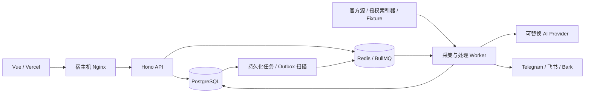

# 04 · 系统架构设计

设计版本：1.0 · 2026-11-02 · 状态：实施基线。实际实现与验证结果以 `docs/19-acceptance-log.md` 为准。

## 1. 技术与边界

采用 pnpm workspace 模块化单体：Vue 3 + TypeScript Strict + Vite 管理端，Hono HTTP API，独立 Node.js LTS Worker。PostgreSQL 是业务事实来源，Drizzle 管理模式与版本迁移；Redis 用于 BullMQ 队列、定时协调、限流及短期状态。API 与 Worker 使用同一版本领域包，可以独立部署和扩容。禁止在 API 入口堆积业务逻辑。

前端托管 Vercel，由同一 GitHub Actions 发布质量链上传预构建静态资源；API/Worker/PostgreSQL/Redis 在 Docker Compose，宿主机 Nginx 代理 API。Web 通过原 API 域名直接请求后端，不接触第三方密钥，所有采集、AI、通知均在服务端。前端域名沿用 `radar.amazingzsys.site`，最终 DNS 映射由用户完成。默认单管理员，实体预留 ownerId，鉴权与查询不能跨用户。

## 2. 处理原则

1. 采集结果先保存原始内容、来源、采集时间、外部标识；正常化失败也能重放。
2. 事件、来源关联、项目指标、信号、规则命中及待发通知在数据库事务内保存。提交后再投递 Redis；重启时扫描待发任务并补投，队列不是唯一事实来源。
3. 数据库唯一约束保证跨 Worker 幂等：源外部项、标准事件指纹、项目资产键、信号键、规则通知键。
4. AI 独立异步队列。AI 缺失不影响确定性检测与已验证 P0/P1 通知。AI 输出不是事实来源。
5. 外部 API 使用超时、有限次数指数退避加抖动、429 Retry-After、熔断和独立配额；分页游标只在原始数据持久化后前进。
6. 断电时可能发生“平台已接受、数据库尚未标记”的重复通知。平台不提供幂等键时不能声称 exactly-once；记录不确定状态，数据库键减少重复。

## 3. 运行模式

- `fixture`：使用显式测试样本，界面与响应永久展示 Fixture 标识，时间是样本时间；不暗示实时、不用于投资绩效。
- `live`：只启用已配置且研究过的 Connector；无数据展示空白/未知，不能自动拿 Fixture 冒充。
- 数据源 metadata 同时说明延迟、来源类型和授权状态。模式切换属于运维配置，不允许客户端注入来源地址。

## 4. 可恢复性

数据库暂不可用：就绪探针失败，任务重试且不提前确认；Redis 重启：BullMQ 恢复持久化队列，数据库补投扫描兜底。采集 Worker 心跳写 Redis/DB，过期标记离线。AI/Telegram 故障：数据仍保存，失败任务有次数、错误类别、下次尝试时间及人工重试。所有进程收到 SIGTERM 后先停止接新任务，再关闭 Worker、连接池和 HTTP。

## 5. 初期范围与扩展

初期真正接入少量官方公开来源，链上全量部署/铸造发现依赖授权索引器；统一链上适配器和 Fixture 验证不能等同于全链覆盖。经济日历保留预期值/实际值 null。Web Push、邮件、全量 Solana/EVM 索引、向量检索、企业 RBAC 作为后续扩展，界面不得显示已上线。优先交付可部署与可追溯的闭环。

## 6. 容量与服务指标

来源级配置轮询周期与延迟目标；不可用统一秒级承诺。API 分页上限 100，详情按需读取原始证据；高频指标先复合索引和保留期，达到容量门槛再按月分区。以真实采样计算发现、处理、排队、平台接受的 P50/P95，空样本显示未知。
